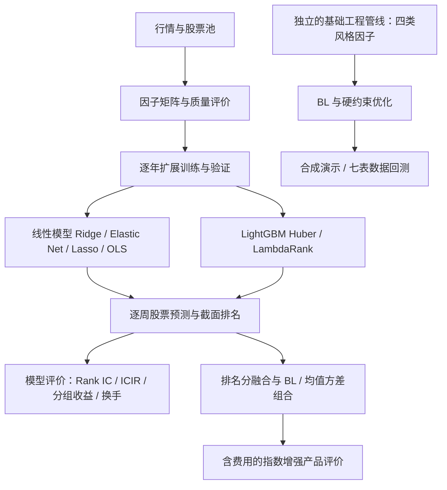

# 中证 A500 多因子选股与指数增强研究

本项目研究一个问题：**能否从股票因子中提取稳定的周度选股信号，并在控制风险和交易成本后形成指数增强组合？**

研究从量价因子出发，比较线性模型与 LightGBM 的预测能力，再讨论预测融合、Black–Litterman（BL）和组合优化。项目源于投资组合管理课程，目前同时保留了研究实验与基础工程管线。

## 从哪里开始读

| 你想了解什么 | 阅读入口 |
| --- | --- |
| 整个项目为什么这样设计，各阶段怎样衔接 | [研究逻辑与方法](docs/RESEARCH_WORKFLOW.md) |
| 没有 Wind 数据，怎样运行一个例子 | 下方“快速运行” |
| 有数据后按什么顺序执行 | [复现指南](docs/REPRODUCING.md) |
| 实验目录太多，先看哪一个 | [结果导航与评价口径](docs/RESULTS.md) |
| 每个文件和模块负责什么 | [代码地图](Code/README.md) |
| 数据授权、代码发布和协作 | [发布边界](docs/OPEN_SOURCE.md) · [贡献指南](CONTRIBUTING.md) |

## 整体流程



最终包已合并到独立的 `Code/product/`，补齐从两组预测到产品回测的流程。原 `run_pipeline.py` 保留基础工程用途，完整产品请使用 [`Code/product/run.py`](Code/product/run.py)，见[产品复现指南](docs/PRODUCT_PIPELINE.md)。

## 当前已经有哪些内容

| 部分 | 当前实现 | 主要入口 |
| --- | --- | --- |
| 单因子评价 | 基础因子注册、周频 IC、组合映射；另有 344 因子的训练期质量报告 | [`run_factor_evaluation.py`](Code/run_factor_evaluation.py)、[`build_factor_quality_report.py`](Code/build_factor_quality_report.py) |
| 线性因子聚合 | Ridge、Elastic Net、Lasso、OLS；训练期筛因子与去相关、验证期选参数 | [`run_linear_model.py`](Code/run_linear_model.py) |
| 树模型因子聚合 | Huber、LambdaRank；逐年滚动、训练期质量筛选、标签对照与审计 | [`run_tree_model.py`](Code/run_tree_model.py) |
| 最终产品管线 | 三套信号 × 六类组合、80/20 产品、费用、持仓校验及图表 | [`product/run.py`](Code/product/run.py) |
| 基础组合管线 | 价值、质量、动量、低波因子 → BL → 硬约束优化 → 回测 | [`run_pipeline.py`](Code/run_pipeline.py) |
| 研究成果 | 因子质量报告、模型分年评价、参数、重要性和系数稳定性 | [`Result/`](Result/README.md) |
| 报告材料 | 仓库中的报告写作底稿；最终包报告 PDF 与本地 LaTeX 演示稿 | [`Report/`](Report/README.md) |

`Code/data_pipeline/`、`Code/portfolio/` 等目录主要是协作说明；核心实现实际集中在 `Code/a500/`，不要把目录名称理解为已完成的模块拆分。

## 快速运行

以下命令均在项目根目录执行，建议 Python 3.10 及以上。合成演示不需要 Wind、因子 parquet 或训练模型。

```bash
python -m venv .venv
source .venv/bin/activate
python -m pip install -r Code/requirements-dev.txt
python -m pytest Code/tests -q
python Code/run_pipeline.py demo --config Code/config.json
```

演示结果写入 `Result/demo/`，用于验证代码和组合约束。它不代表真实股票回测收益。Windows 激活环境可使用 `.venv\Scripts\activate`。

要复现因子或模型实验，还需准备相应的本地行情和因子矩阵，详见[复现指南](docs/REPRODUCING.md)。

最终包产品复现：

```bash
python -m pip install -r Code/requirements-product.txt
python Code/product/run.py --check-inputs
python Code/product/run.py
```

需将最终包授权输入放到 `Data/product/` 或指定 `A500_PRODUCT_DATA`，默认输出 `Result/reproduced/`。输入布局和重训开关见[产品流程](docs/PRODUCT_PIPELINE.md)。

## 怎样理解研究结果

- **训练集因子统计、模型预测评价、最终产品回测是三个层次**，不能把其中某个收益直接当作另一层的收益。
- 现有开发股票池使用可观察股票集合向历史回看；模型收益标签使用未复权价格。它们与完整历史成分、复权口径的正式 A500 研究存在差异。
- 树模型标签调优前已查看 2024–2026 年测试结果，后续结果属于探索性复评，尚无新的独立检验；2026 年为部分年度。
- 仓库里包含实际因子、部分预测、模型和历史研究产物，`.gitignore` 不会清除已跟踪文件或提交历史。源码发布边界和授权问题见[发布说明](docs/OPEN_SOURCE.md)。

为避免混淆，首页不把单个实验数字作为全项目的“最终收益”。请从[结果导航](docs/RESULTS.md)进入对应配置和评价报告。

## 目录概览

```text
Code/           执行入口、核心 a500 包、配置与测试
Data/           行情、因子矩阵及字段说明；实际数据受授权约束
Result/         因子与模型的研究结果、基础管线输出
models/         按实验、模型和年度保存的已训练模型
Report/         报告底稿与本地报告材料说明
Presentation/   汇报结构
docs/          研究流程、复现、结果导航和发布说明
scripts/       源码导出工具
```

当前尚未选定开源许可证。项目对外发布前需确认代码权利、第三方来源及数据授权；详见[发布说明](docs/OPEN_SOURCE.md)。
