# 双模型融合分数版：组合优化与回测报告

> 本报告记录将线性模型（Ridge）与树模型（LightGBM）的截面排名分各按50%融合，再接入既有组合优化与回测管线的全部步骤。报告结构与图表样式参照`final/`和`final_tree/`。所有本次产物位于`final_fusion/`。

---

## 0. 总体流程

```text
final/predictions_external.parquet + final_tree/predictions_tree.parquet
        │ run_pipeline.py：按周×股票校验、信号日一致性校验、防前视校验
        ▼
融合分数 = 50%线性排名分 + 50%树模型排名分（平均后不重新排名）
        ▼
predictions_fusion.parquet（133周×500只）
        ├─ portfolio_opt_v1_fusion.py → BL / 风险约束BL / MV / 等权
        ├─ portfolio_opt_v2_fusion.py → MV+约束
        └─ portfolio_opt_v3_fusion.py → BL+约束
        ▼
backtest_fusion.py → evaluate_fusion.py → render_all_artifacts.py
        ▼
净值与超额图、主动/产品指标表、费用分层、月度胜率、换手、年度表、同业与三模型对比
```

## 1. 输入数据

| 项目 | 内容 |
|---|---|
| 线性分数 | `final/predictions_external.parquet`，Corr 0.50因子筛选＋Ridge模型的对齐排名分 |
| 树模型分数 | `final_tree/predictions_tree.parquet`，LightGBM Huber、clipped_relative标签的对齐排名分 |
| 融合方式 | 固定50/50，按`pred_week, securityID`一一对应；不填补缺失、不重新排名 |
| 行数与覆盖 | 66,500行，133周×500只，第196—328周 |
| 行情与行业 | 原项目`processed_data.parquet`及申万一级行业权重；行业数据自2024-09-23起可用 |
| 基准与同业 | 中证A500全收益、上证综合全收益、沪深300全收益、中证500全收益；五只基金净值仅用于待复核图 |

## 2. 预测分数准备（run_pipeline.py）

沿用原始分数准备的5交易日块编号：信号位于面板索引i时，最早用于第`i//5+2`周；第T周信息截止日为`(T−1)×5−1`。
对两模型的每个周股票键做外连接并要求全部匹配；检查信号日相同、分数在[0,1]且无缺失，再逐行平均。
对融合信号逐行核验`feature_dt ≤ 信息截止日`。`fusion_signal_audit.parquet`保留两侧分数与融合值，输入哈希记录于`run_manifest.json`。

本次重新选股、求解持仓、计算收益及漂移换手；不是把原有净收益序列平均。基础预测模型未重新训练，50/50比例未根据本窗口选优。

## 3. 三版组合优化（周频调仓，固定50/50融合分数）

### 3.1 共同设定

- **回测期**：2024-01-08 ~ 2026-10-09，对应第 196~328 周，共 133 个调仓周；
- **候选池**：每周取分数最高的 30 只股票（N_TOP = 30，沿用锁定设计）；
- **分数 → 预期收益映射**：α = 分数 × σ_cs，其中 σ_cs = 研发期（2020-2023 年）每周截面收益标准差的均值（把 0-1 排名分映射回周频预期收益量纲）；
- **协方差矩阵**：过去 40 个交易日日收益，先做极端值处理（|日收益| > 0.2 置 0，再按每只股票 40 日窗口做中位数 MAD 去极值，倍数 3.0），再周频化 Σ_week = 5 × Σ_day，对角加 1e-8 保证正定；
- **风险厌恶系数** δ = 2.5（沿用锁定设计）。

### 3.2 v1：四组合（portfolio_opt_v1_fusion.py）

每周对 top-30 候选池直接构造四种组合：

| 组合 | 构造方式 |
|---|---|
| **BL组合** | 逆向优化 Π = δΣw_eq（w_eq = 1/30）；观点 P = I（每个股票的"观点"即其自身预测分），Q = 预测分 × σ_cs；观点不确定性 Ω = τ·diag(PΣPᵀ)，τ = 0.05；后验收益 μ_post → Markowitz 最大化（无卖空、个股权重 ≤ 0.1）；Σ 用**未处理**日收益 |
| **风险约束BL** | Σ 用**处理后**日收益；目标函数 = 夏普比率 − 0.2 × VaR(95%, 周频)，VaR 分位数 z = 1.645；s.t. w ≥ 0、Σw = 1、w ≤ 0.1 |
| **MV组合** | Σ 用处理后日收益；max αᵀw − (δ/2)wᵀΣw，s.t. w ≥ 0、Σw = 1、个股权重 ≤ 0.1 |
| **等权组合** | 各 1/30 |

输出 `portfolio_weights_v1_fusion.parquet`（列：week, feature_dt, securityID, bl_w, blrisk_w, mv_w, eq_w）。

### 3.3 v2：MV+约束组合（portfolio_opt_v2_fusion.py）

- **选股信号平滑**：用最近 4 周分数的滚动均值（SMOOTH_K = 4，滚动仅用过去值，无前视）取 top-30。该平滑设定沿用既有方案，本次未重新选择窗口；
- **目标函数**（cvxpy + OSQP 凸优化求解，失败则退回等权）：

```
max  αᵀw − (δ/2) wᵀΣw − λ_ind‖Hᵀw − b‖² − λ_turn‖w − w_prev‖₁
s.t. w ≥ 0,  Σw = 1,  w ≤ 0.1
```

- **行业中性软约束**：λ_ind = 0.5，H 为候选池股票的申万一级行业 one-hot 矩阵，b 为基准行业权重（按行业数据中的指数成分权重汇总并归一）。惩罚组合行业权重与基准的平方偏离。行业数据自 2024-09-23 起可用，此前不加行业惩罚（λ 视为 0）；
- **换手惩罚**：λ_turn = 0.002，w_prev = 上周权重按持有期收益漂移后对齐到本期候选池（新进池股票记 0）：

```
w1h = w1 × (1 + r_i) / (1 + r_port)
```

  （同一候选池股票的漂移权重与回测一致；被移出候选池的强制卖出不在优化变量中）；
- 输出 `portfolio_weights_v2_fusion.parquet` 与行业偏离检查表 `industry_deviation_v2_fusion.parquet`。

### 3.4 v3：BL+约束组合（portfolio_opt_v3_fusion.py）

与v2相比，预期收益构造与协方差处理均有变化。预期收益方面，把"分数 × σ_cs 直接用"换成 Black-Litterman 后验收益（He & Litterman 1999）：

```
Π = δΣw_eq（逆向优化，w_eq = 1/30）
P = I，Q = 平滑分数 × σ_cs
Ω = τ·diag(PΣPᵀ)，τ = 0.05
μ_post = Π + τΣPᵀ(PτΣPᵀ + Ω)⁻¹(Q − PΠ)
```

- Σ 用**未处理**日收益（与锁定版 BL 口径一致）；
- 硬约束为 w ≥ 0、Σw = 1、w ≤ 0.1；
- 行业中性软约束（λ_ind = 0.5）与换手惩罚（λ_turn = 0.002）与 v2 完全相同，但因协方差处理也有区别，两者对比不能单独归因于BL后验。

### 3.5 三版参数汇总

| 参数 | 取值 | 说明 |
|---|---|---|
| N_TOP | 30 | 每周候选池股票数 |
| COV_DAYS | 40 | 协方差估计窗口（交易日） |
| DELTA | 2.5 | 风险厌恶系数 |
| TAU | 0.05 | BL 观点不确定性系数 |
| CAP | 0.1 | 个股权重上限（除等权外全部组合） |
| EXTREME / MAD_K | 0.2 / 3.0 | 日收益极端值处理 |
| VAAR_Z / VAAR_LAMBDA | 1.645 / 0.2 | 风险约束BL 的 VaR 惩罚 |
| SMOOTH_K | 4 | v2/v3 选股信号平滑窗口 |
| LAMBDA_IND | 0.5 | 行业中性软约束惩罚系数 |
| LAMBDA_TURN | 0.002 | 换手惩罚系数 |
| INDCON_START | 2024-09-23 | 行业约束生效起点（数据起点） |

## 4. 统一回测（backtest_fusion.py）

### 4.1 周收益计算

- 第 T 周组合收益：r_T = Σ w_i × (close[5T−1] / close[5(T−1)−1] − 1)，其中权重 w_i 是第 T−1 周最后一个交易日（信息截止日）解出的；
- 指数周收益按与个股完全相同的交易日对齐（缺失交易日向前填充）；
- 回测窗口：第 196~328 周，共 133 周，2024-01-08 ~ 2026-10-09（首个收益观测日为2024-01-15）。

### 4.2 指增产品口径（汇报口径）

```
r_prod = 0.8 × r_idx + 0.2 × r_active
```

即 80% 中证A500全收益 + 20% 主动组合，**周频再平衡**。扣费前每周算术超额 = 0.2 × 主动组合每周算术超额；复合超额需根据净值另算。主动组合是中间结果，正式汇报用产品口径。

### 4.3 换手率（单边、漂移调整）

每次调仓只算**买入侧**（对称的卖出侧不计）：

```
w1h = w_T × (1 + r_i) / (1 + r_p)          # 上周权重按持有期收益自然漂移
t   = 0.5 × Σ|w_{T+1} − w1h|               # 本期单边换手
t₀  = 0.5 × Σ|w₀|                          # 首周建仓（空仓→满仓）也计一次
年化换手 = Σt × 52 / 周数
产品口径换手 = 0.2 × 主动换手
```

### 4.4 交易成本与管理费

| 项目 | 取值 | 收取方式 |
|---|---|---|
| 单边交易成本 | 0.15%（打包：佣金 + 印花税 + 冲击成本） | r_net = r − 0.0015 × turn，在调仓周收取 |
| 管理费 | 0.5% / 年 | 周化 FEE_W = (1.005)^(1/52) − 1，对产品全部净值收取：r_prod_net = 0.8×r_idx + 0.2×r_net − FEE_W |
| 托管费 | 未扣 | — |
| 无风险利率 | 0 | 夏普比率计算用 |

### 4.5 业绩指标

- 全期指标：累计收益 Π(1+r) − 1；年化收益 (1+total)^(52/n) − 1；年化波动 std × √52；夏普 (mean − RF/52) / std × √52；最大回撤 = 净值曲线相对历史高点的最大跌幅；
- 超额指标：累计超额 Π(1+rp)/Π(1+rb) − 1；年化超额；跟踪误差 TE = std(rp − rb) × √52；信息比率 IR = mean(rp − rb) × 52 / TE；周胜率 = P(周超额 > 0)。


本次仅将OSQP绝对/相对容差设为1e-9、启用polishing，持仓边界按1e-7数值容差校验。行业中性为软惩罚，并非严格中性或跟踪误差硬上限。


## 5. 回测结果（133周，产品80/20口径）

### 5.1 主动组合指标（已扣交易成本0.15%）

| 组合 | 累计收益 | 年化收益 | 年化波动 | 最大回撤 | 夏普比率 | 年化超额 | 跟踪误差(年化) | 信息比率 | 周胜率 | 年化换手(单边) |
|---|---|---|---|---|---|---|---|---|---|---|
| 中证A500全收益指数 | 45.44% | 15.77% | 20.81% | -16.29% | 0.81 | 0.00% | 0.00% | — | — | — |
| BL组合 | 124.66% | 37.23% | 43.70% | -37.69% | 0.94 | 18.53% | 32.19% | 0.75 | 52.63% | 44.75x |
| 风险约束BL | 55.10% | 18.72% | 29.68% | -24.88% | 0.72 | 2.54% | 20.10% | 0.23 | 43.61% | 44.31x |
| MV组合 | 126.75% | 37.72% | 34.30% | -24.77% | 1.11 | 18.96% | 23.57% | 0.90 | 53.38% | 43.54x |
| 等权组合 | 102.79% | 31.84% | 34.34% | -26.61% | 0.97 | 13.88% | 21.77% | 0.77 | 50.38% | 39.74x |
| MV+约束组合 | 191.16% | 51.87% | 36.50% | -25.30% | 1.32 | 31.18% | 24.44% | 1.29 | 54.14% | 16.33x |
| BL+约束组合 | 192.54% | 52.15% | 37.41% | -24.85% | 1.31 | 31.42% | 25.70% | 1.25 | 54.14% | 20.55x |

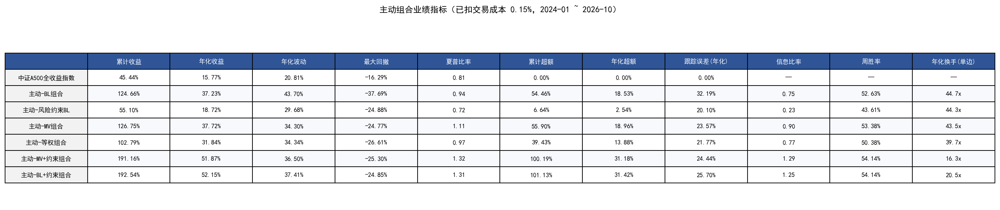

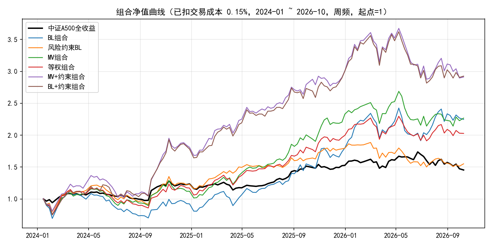

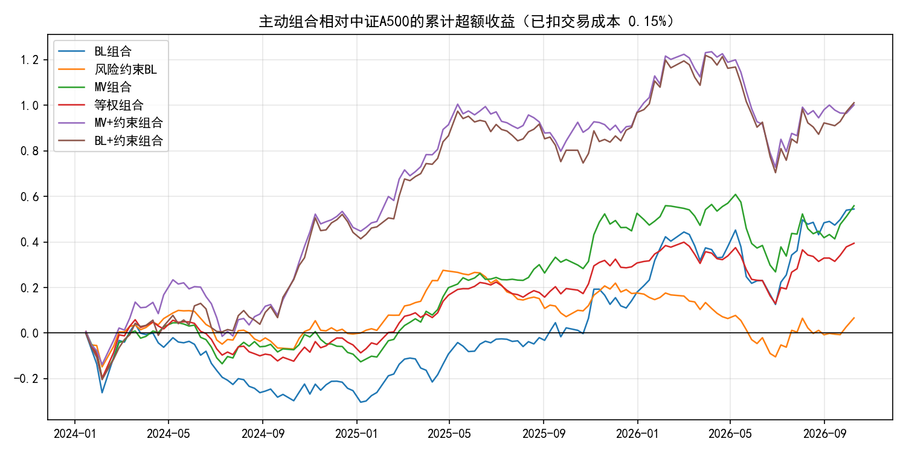

### 5.2 指增产品指标（已扣交易成本与管理费，正式汇报口径）

| 组合 | 累计收益 | 年化收益 | 年化波动 | 最大回撤 | 夏普比率 | 年化超额 | 跟踪误差(年化) | 信息比率 | 周胜率 | 年化换手(单边) |
|---|---|---|---|---|---|---|---|---|---|---|
| 中证A500全收益指数 | 45.44% | 15.77% | 20.81% | -16.29% | 0.81 | 0.00% | 0.00% | — | — | — |
| BL组合 | 59.89% | 20.14% | 23.72% | -17.02% | 0.89 | 3.77% | 6.44% | 0.68 | 51.88% | 8.95x |
| 风险约束BL | 46.65% | 16.15% | 21.40% | -14.64% | 0.80 | 0.32% | 4.02% | 0.11 | 42.86% | 8.86x |
| MV组合 | 58.74% | 19.80% | 22.20% | -14.00% | 0.92 | 3.48% | 4.71% | 0.79 | 52.63% | 8.71x |
| 等权组合 | 54.93% | 18.67% | 22.50% | -14.98% | 0.87 | 2.50% | 4.35% | 0.65 | 49.62% | 7.95x |
| MV+约束组合 | 66.96% | 22.19% | 22.74% | -14.54% | 0.99 | 5.54% | 4.89% | 1.19 | 54.14% | 3.27x |
| BL+约束组合 | 67.36% | 22.31% | 22.82% | -14.18% | 1.00 | 5.64% | 5.14% | 1.15 | 54.14% | 4.11x |

融合BL+约束产品年化超额5.64%、信息比率1.15；融合MV+约束年化超额5.54%、信息比率1.19、年化单边换手3.27倍。
两者收益接近，MV+约束的主动风险效率与换手更优，BL+约束的最大回撤略浅。其余四种组合保留作方法对照。

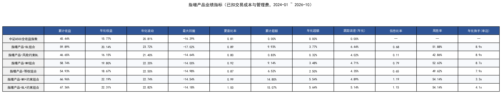

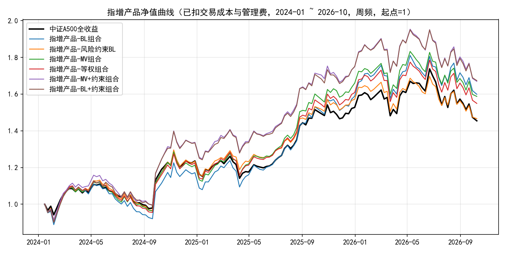

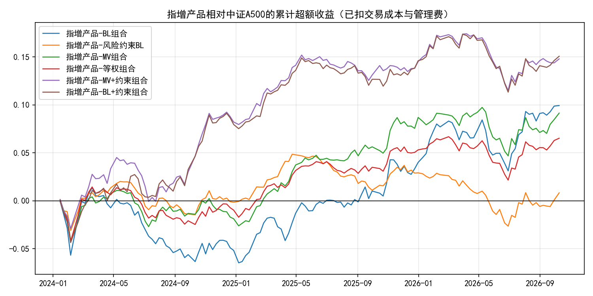

### 5.3 扣成本费用前后对比（产品年化超额）

| 组合 | 年化超额(毛) | 年化超额(扣交易) | 年化超额(扣交易+管理费) |
|---|---|---|---|
| 指增产品-BL组合 | 5.70% | 4.29% | 3.77% |
| 指增产品-风险约束BL | 2.17% | 0.82% | 0.32% |
| 指增产品-MV组合 | 5.36% | 4.00% | 3.48% |
| 指增产品-等权组合 | 4.24% | 3.01% | 2.50% |
| 指增产品-MV+约束组合 | 6.59% | 6.07% | 5.54% |
| 指增产品-BL+约束组合 | 6.82% | 6.17% | 5.64% |
| 中证A500全收益指数 | 0.00% | 0.00% | 0.00% |

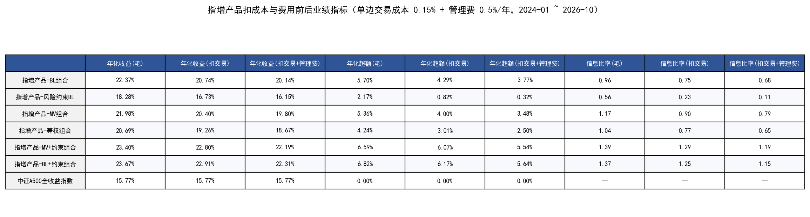

### 5.4 分年度业绩（产品与指数同窗口，年化收益）

| 名称 | 2024年化收益 | 2025年化收益 | 2026年化收益 |
|---|---|---|---|
| BL组合 | 19.19% | 38.10% | 0.91% |
| 风险约束BL | 26.19% | 29.29% | -9.30% |
| MV组合 | 23.78% | 39.56% | -6.10% |
| 等权组合 | 25.04% | 33.66% | -5.14% |
| MV+约束组合 | 37.93% | 32.97% | -6.34% |
| BL+约束组合 | 37.57% | 33.40% | -6.11% |
| 中证A500全收益 | 26.40% | 25.21% | -6.65% |
| 上证综合全收益 | 23.92% | 21.32% | -3.01% |
| 沪深300全收益 | 27.88% | 20.91% | -6.92% |
| 中证500全收益 | 18.47% | 30.56% | -2.57% |

年度直接复合该年所有已有周收益，保留每年第一笔收益；跨年周按期末日期归属。指数按相同周起止日取收益并使用52周年化。
这修正了原年度脚本先截取净值再pct_change漏掉年首收益、以及产品与指数起点不同的问题，因此年度数字不能直接与原目录年度表混用。
完整年度表同时列出年化波动、夏普、最大回撤。2026截至10-09；首末年度不完整。


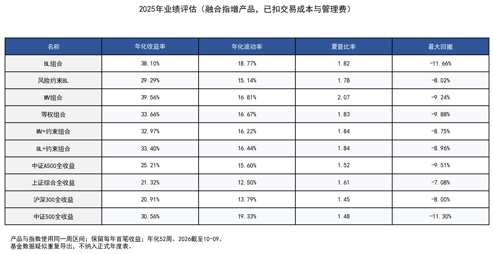

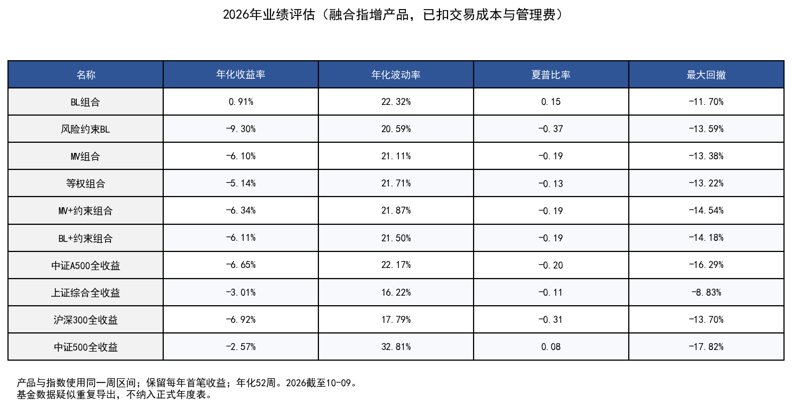

### 5.5 同业对比

| 名称 | 累计收益 |
|---|---|
| 中证A500全收益 | 45.44% |
| 上证综合全收益 | 42.50% |
| 沪深300全收益 | 41.94% |
| 中证500全收益 | 47.11% |
| 融合产品-MV+约束组合 | 66.96% |
| 融合产品-BL+约束组合 | 67.36% |

指数与两种融合产品从2024-01-08同一起点归一为1，产品净值已扣费，指数未额外扣费。
基金图分别将每只基金、两种产品和A500基准在该基金可用区间的共同起点归一为1。五只基金的起算日不同，因此只在各自子图内进行同期累计收益比较。

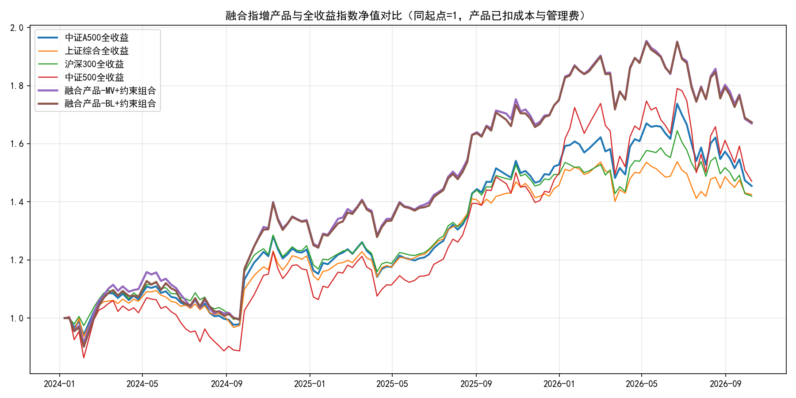

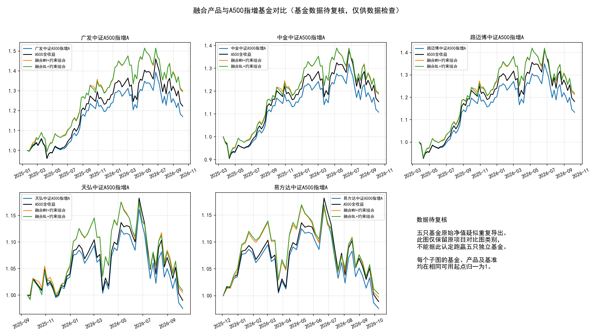

### 5.6 月度超额胜率（指增产品vs中证A500全收益）

| 组合 | 2024 | 2025 | 2026 | 合计 |
|---|---|---|---|---|
| BL组合 | 5/12 | 10/12 | 7/10 | 22/34 |
| 风险约束BL | 6/12 | 7/12 | 4/10 | 17/34 |
| MV组合 | 6/12 | 9/12 | 5/10 | 20/34 |
| 等权组合 | 5/12 | 11/12 | 6/10 | 22/34 |
| MV+约束组合 | 8/12 | 8/12 | 6/10 | 22/34 |
| BL+约束组合 | 8/12 | 8/12 | 7/10 | 23/34 |

按周收益期末所属月份复合，与原月度图保持一致；首末月及跨月周不是精确自然月日频收益。

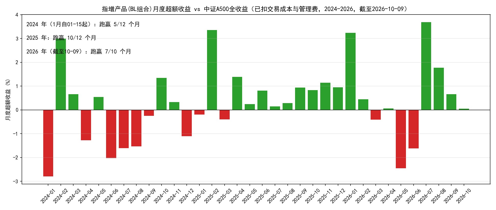

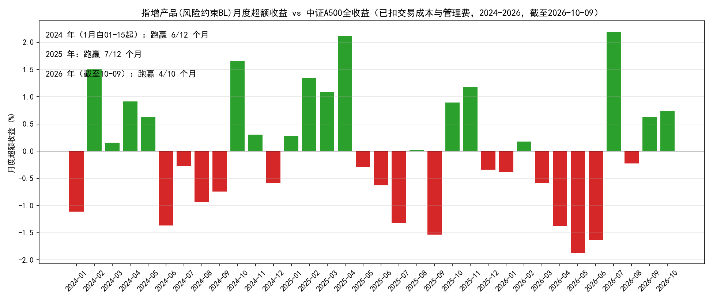

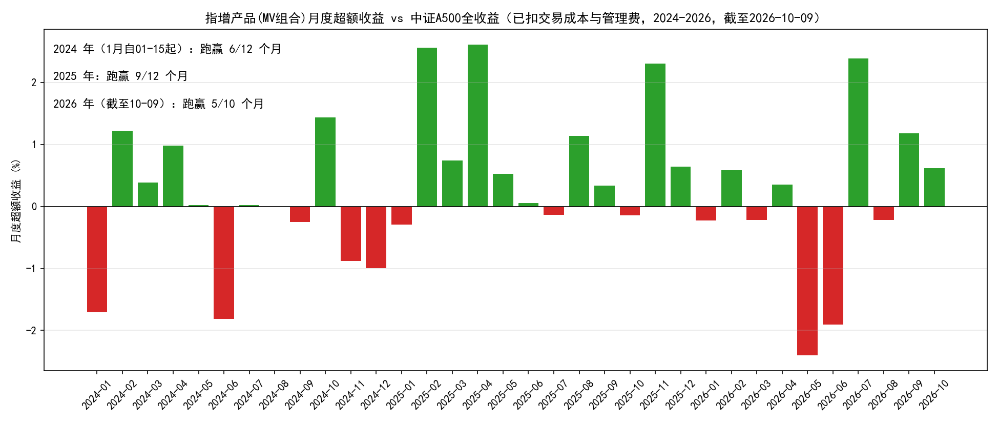

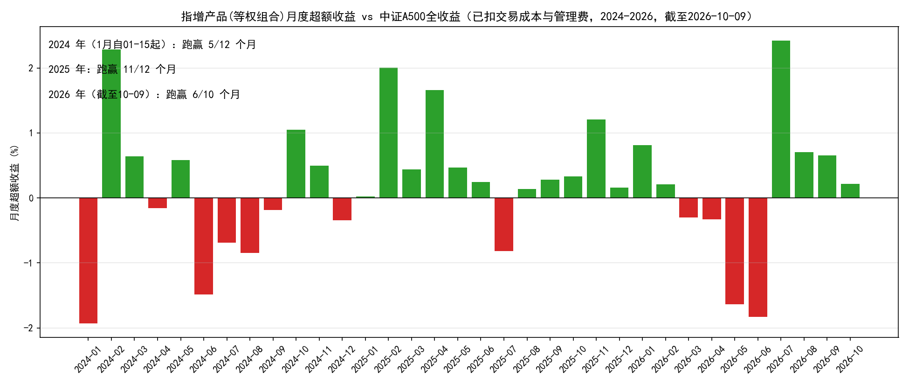

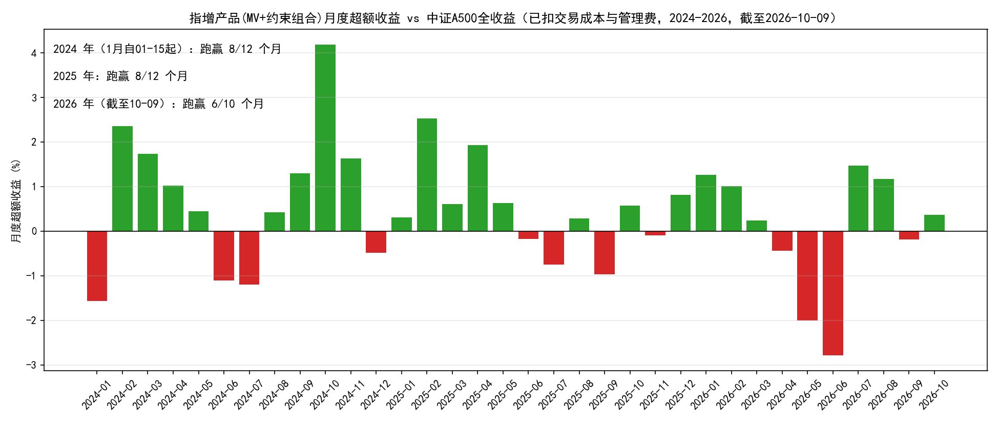

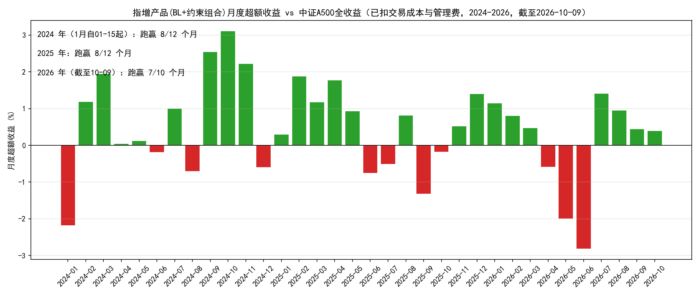

### 5.7 年化换手率（产品口径=0.2×主动口径）

| 组合 | 年化换手(单边) |
|---|---|
| BL组合 | 8.95x |
| 风险约束BL | 8.86x |
| MV组合 | 8.71x |
| 等权组合 | 7.95x |
| MV+约束组合 | 3.27x |
| BL+约束组合 | 4.11x |

本报告统一将首期建仓计入换手并按`Σturn×52/n`年化。旧目录指标文件排除首期并按n−1年化，有小幅差异。

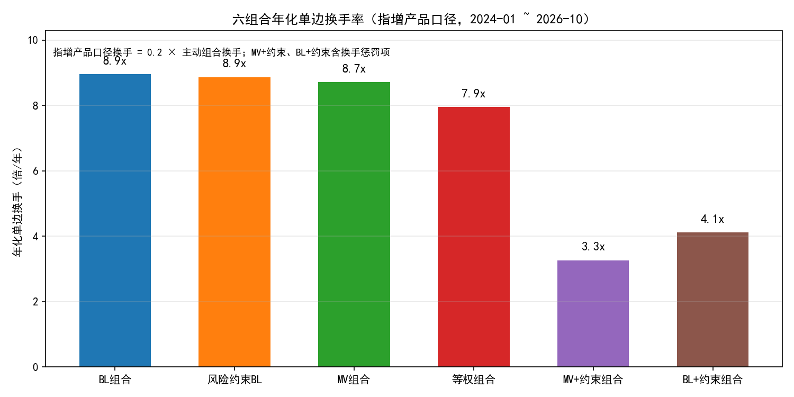

## 6. 与线性、树模型分数版对比（同窗口、同口径）

| 组合 | 模型 | 年化收益 | 最大回撤 | 年化超额 | 跟踪误差 | 信息比率 | 年化单边换手 |
|---|---|---|---|---|---|---|---|
| BL组合 | 线性 | 23.06% | -15.28% | 6.30% | 5.56% | 1.21 | 9.24x |
| BL组合 | 树模型 | 17.20% | -13.84% | 1.23% | 6.12% | 0.29 | 8.32x |
| BL组合 | 融合 | 20.14% | -17.02% | 3.77% | 6.44% | 0.68 | 8.95x |
| 风险约束BL | 线性 | 15.88% | -14.22% | 0.09% | 3.34% | 0.05 | 9.09x |
| 风险约束BL | 树模型 | 15.44% | -14.95% | -0.29% | 4.56% | -0.01 | 8.24x |
| 风险约束BL | 融合 | 16.15% | -14.64% | 0.32% | 4.02% | 0.11 | 8.86x |
| MV组合 | 线性 | 17.22% | -14.20% | 1.25% | 3.80% | 0.38 | 9.21x |
| MV组合 | 树模型 | 17.68% | -14.84% | 1.64% | 4.81% | 0.41 | 8.27x |
| MV组合 | 融合 | 19.80% | -14.00% | 3.48% | 4.71% | 0.79 | 8.71x |
| 等权组合 | 线性 | 19.73% | -14.33% | 3.42% | 3.79% | 0.99 | 8.47x |
| 等权组合 | 树模型 | 17.86% | -13.97% | 1.80% | 4.64% | 0.46 | 7.29x |
| 等权组合 | 融合 | 18.67% | -14.98% | 2.50% | 4.35% | 0.65 | 7.95x |
| MV+约束组合 | 线性 | 19.76% | -14.89% | 3.44% | 4.35% | 0.85 | 3.67x |
| MV+约束组合 | 树模型 | 20.20% | -14.58% | 3.82% | 4.88% | 0.86 | 3.34x |
| MV+约束组合 | 融合 | 22.19% | -14.54% | 5.54% | 4.89% | 1.19 | 3.27x |
| BL+约束组合 | 线性 | 21.03% | -14.71% | 4.54% | 4.66% | 1.04 | 4.83x |
| BL+约束组合 | 树模型 | 20.88% | -12.95% | 4.41% | 5.54% | 0.88 | 4.04x |
| BL+约束组合 | 融合 | 22.31% | -14.18% | 5.64% | 5.14% | 1.15 | 4.11x |

融合BL+约束年化超额由线性版4.54%提高至5.64%，IR由1.04提高至1.15；融合MV+约束的IR达到1.19，高于对应的线性/树模型方案。
这种改善来自融合后重新选股和统一优化，不能用原组合净值混合的结果替代解释；现有实验尚不能单独识别每一优化环节的贡献。

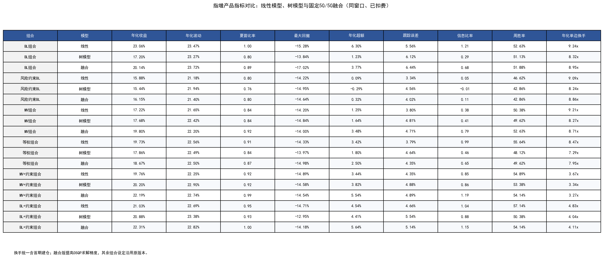

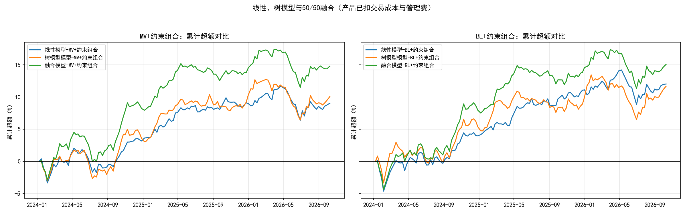

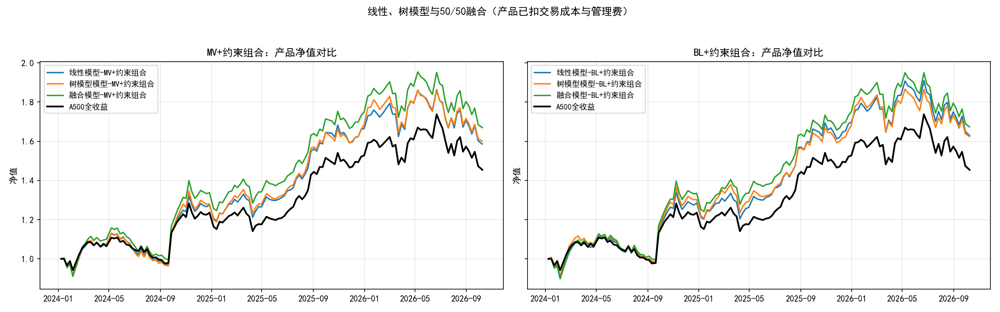

## 7. 结论、数据质量与限制

- 本次预先固定50/50信号融合，受约束组合在本历史窗口的收益与信息比率改善；BL+约束为执行前指定主方案，MV+约束为低换手备选。
- 从本次产品结果看，MV+约束值得成为下一阶段优先验证候选，但不能事后把最高指标当作预先选定策略的成绩。
- 全期改善不等于每阶段占优：2026融合BL+约束累计超额约0.41%，低于两套单模型的对应值。年度同窗口统计见CSV。
- 固定500只股票池存在幸存者偏差；未复权价格可能扭曲标签与持仓收益；未模拟停牌、涨跌停和实际成交容量。
- 行业仅采用偏离软惩罚，自2024-09-23起生效；产品没有严格行业中性或跟踪误差硬约束。
- 五只基金按各自可用起点与产品、A500基准同期归一化比较；不同基金区间、策略、费率与风险暴露不完全相同。
- 单边成本0.15%和年管理费0.5%沿用原设定；被动复制成本、托管费及额外仓位再平衡成本未单列。首期建仓采用原回测0.5×权重和定义。
- 基础模型已经过研究筛选，本窗口仍是研究评价；融合比例虽固定，也不构成新的独立样本外验证。

## 8. 文件与复现清单

| 脚本 | 功能 | 主要输出 |
|---|---|---|
| `run_pipeline.py` | 固定50/50融合、生成优化脚本快照、一键完整运行 | 融合预测、运行清单与日志 |
| `portfolio_opt_v1_fusion.py` | 四组合优化 | v1权重parquet |
| `portfolio_opt_v2_fusion.py` / `portfolio_opt_v3_fusion.py` | MV/BL约束优化 | v2/v3权重与行业偏离parquet |
| `backtest_fusion.py` | 六组合统一回测 | 周收益、净值、指标、基础图4张 |
| `evaluate_fusion.py` | 独立校验与三模型同窗口统计 | 校验JSON、对比/年度/月度CSV |
| `render_metric_tables.py` / `cost_adjusted.py` | 原样式指标与费用表 | 指标表3张与费用CSV |
| `render_monthly_win_plots.py` / `render_turnover_plot.py` | 原样式月度与换手图 | 月度6张、换手1张 |
| `extract_peer_data.py` | 只读提取原Wind工作簿 | 同业输入JSON |
| `render_all_artifacts.py` | 年度、同业、三模型图及本报告 | 年度3张、同业2张、对比3张、图表对照清单 |

完整对应原目录的图表共22张，另保留上一版融合概览图2张，见`chart_inventory.csv`逐一对应清单。
在A500目录运行：`python final_fusion/run_pipeline.py`。仅更新`final_fusion/`，原始`final/`与`final_tree/`不变。
如仅需重绘图表和报告：`python final_fusion/render_all_artifacts.py`。

全部持仓、收益、漂移换手及扣费已独立核验，见`validation_results.json`。
