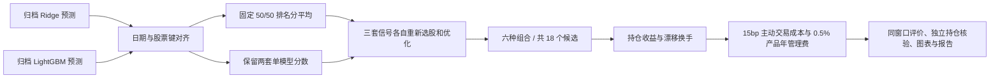

# 最终产品流程与代码包合并

[返回首页](../README.md) · [研究方法](RESEARCH_WORKFLOW.md) · [结果导航](RESULTS.md)

最终小组代码包补齐了预测到组合的研究流程。本次将其放入 `Code/product/`，保留原有 `Code/a500/` 和单模型实验入口；两者不互相覆盖。最终产品流程的运行入口为：

```bash
python -m pip install -r Code/requirements-product.txt
python Code/product/run.py --check-inputs
python Code/product/run.py
```

## 数据到结果的完整链条



模型周频预测与产品五交易日评价块不同：信号按交易日历映射至组合块，最终冻结产品评价为 133 块，而模型预测评价为 141 周。不能用“周数相同”代替日期和样本对齐。

## 默认运行与重训

默认读取归档预测，不重训基础模型，然后重新计算组合权重、收益与费用，不是直接展示冻结净值。

```bash
# 重新训练对应模型，再把新预测接入组合流程
python Code/product/run.py --train-tree
python Code/product/run.py --train-linear

# 只跳过完整图表集；仍进行组合、回测、评价与校验
python Code/product/run.py --skip-charts

# 已有本次重算结果时，只重绘图表及报告
python Code/product/run.py --charts-only
```

重训时线性预测只取 Ridge，树模型只取 Huber；拒绝重复股票键或混合多个模型版本。最终 Ridge 配置来自包内 `Data/provenance/linear/run_config.json`，相关性阈值为 0.50，不能误用原研究默认的 0.70 配置。

重新训练的数值会受依赖版本和求解器影响，不保证逐位重现。重训模式仍执行费用与持仓一致性检查，但不把新模型强行对齐旧预测的冻结收益。

## 本地输入布局

将最终包中下列内容放到 `Data/product/`，或用环境变量 `A500_PRODUCT_DATA` 指向同结构的数据目录：

```text
Data/product/
  raw/
    processed_data.parquet
    a500_constituents_sw2021l1.parquet
    中证A500全收益指数.xlsx
    中证A500价格指数每日收盘价.xlsx
    其他指数或指增产品/*.xlsx
  predictions/
    linear_oos.parquet
    tree_oos.parquet
  factor_store/alpha158_values/*.parquet
  factor_store/gtja191_values/*.parquet
  provenance/linear/...
  provenance/tree/...
  data_manifest.json
```

默认重放归档预测时不要求因子矩阵；重训还需要因子矩阵及数据清单。线性训练的辅助单因子统计来自仓库中 `Result/factor_reports/train_2020_2022/factor_summary.csv`。

原始数据、因子与逐股票预测只作为本地输入；本次合并不把它们新增到 Git。`Data/Result/` 是包内的重复成果目录，不作为另一份数据源导入。

输出位于 `Result/reproduced/`，可用 `A500_PRODUCT_OUTPUT` 指定新的绝对目录，以保留已有重算。冻结汇总和报告位于 `Result/reference/`，运行过程中不覆盖。

## 组合与费用口径

三套信号分别是 Ridge、LightGBM、固定融合；每套进入 BL、风险 BL、MV、等权、MV 加软惩罚、BL 加软惩罚六种组合。

- 主动候选股票数为 30，协方差窗口 40 交易日；软惩罚组合先做最近 4 个信号块的均分平滑。
- 满仓、只做多、主动组合个股上限 10% 属于持仓约束；行业和换手是惩罚项，不是严格行业中性或换手硬上限。
- 产品按 80% 全收益指数复制加 20% 主动组合构造。
- 单边交易成本 15bp 作用于主动组合漂移后的单边换手；年管理费 0.5% 作用于全部产品。首期建仓沿用原实现的半权重和口径。
- 汇总换手区分主动组合与折算到产品的主动部分；不代表整个被动加主动基金的全部交易量。

这些口径与原基础管线中的 20bp 成本、6% TE 硬约束等配置不同。

## 代码包合并时修复了什么

| 包内问题 | 合并方式 |
| --- | --- |
| `a500/tree_model.py` 是转发桥，直接覆盖会破坏原树模型实现 | 保留于独立的 `Code/product/a500/`，原包不变 |
| `paths.py` 假设直接位于包的 `Code/` | 调整为定位仓库根目录，支持本地数据和输出目录环境变量 |
| `run.py` 导入不存在的 `verify_reproduction` | 补齐输入预检、费用恒等式、独立持仓校验和冻结收益差异记录 |
| `--train-linear` 训练完仍读旧归档预测 | 返回新预测文件并显式接入分数对齐；限定 Ridge |
| 线性重训把行业表当历史训练股票池传入 | 改为与原研究一致的显式开发股票池，不伪称历史成分正式回测 |
| 打包默认线性配置与最终 Ridge 来源不一致 | 使用包内溯源配置的 0.50 相关阈值 |
| 缺少 `Result/reference`，绘图和报告依赖失效 | 从最终包成果恢复只读参考汇总、方法说明和必要图表 |
| `fusion/` 留有重复旧入口和 Windows 绝对路径 | 不导入为第二条可执行主线；对应逻辑已由产品主入口、信号和三种优化模块覆盖 |

原始源码哈希与来源包 SHA-256 见 [`FINAL_PACKAGE_MANIFEST.json`](FINAL_PACKAGE_MANIFEST.json)。包内旧目录 README 的旧命令不是当前复现入口，请以本页为准。

## 校验与研究限制

`evaluation.py` 会独立从持仓与价格核验融合组合的权重边界、原始收益、漂移换手和费用；`verify_reproduction.py` 再核对三套信号的产品收益恒等式并记录与冻结周收益的最大差异。差异超出容差会明确报告，不宣称精确重现。求解器未收敛时，部分原研究优化方法会记录告警并返回等权，需检查日志；这是继承实现，不能当作所有优化均成功的证明。

保留的研究限制包括固定股票池、未复权行情、行业映射前后填充、部分年度样本、理想指数复制、未模拟涨跌停与成交容量。早期模型和融合方案经过同窗口研究筛选，因此不是新增的独立样本外验证。文件合并与程序跑通不会消除这些限制。

## 本次验证记录

合并后已使用最终包归档预测跑通三套信号、18 个候选组合和完整图表/报告生成，每套信号的共同持仓评价均为 133 块；费用恒等式与融合持仓独立核验通过。重算融合 BL 加软惩罚的产品年化复合超额约 5.62%，冻结报告约 5.64%。本次重算与冻结周收益有差异，尚未将其归因为某一个求解器或环境因素，不能声称精确复现。冻结结果未覆盖；每次实际差异和环境版本写入本地 `Result/reproduced/reproduction_check.json`。
